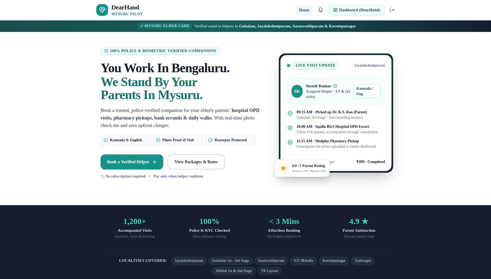
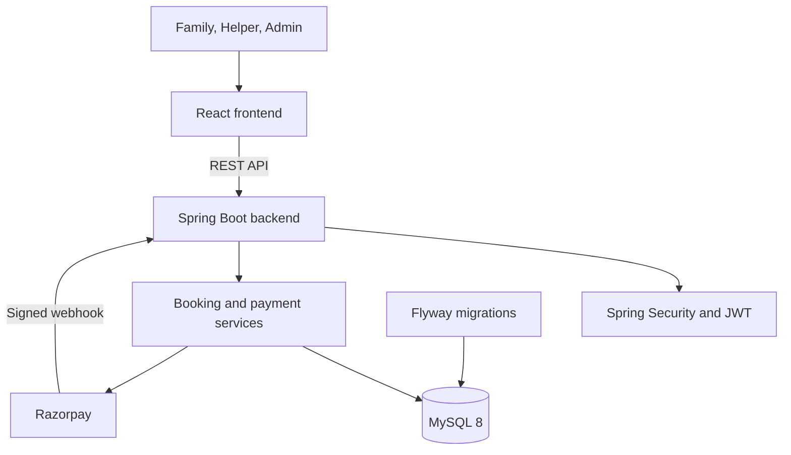
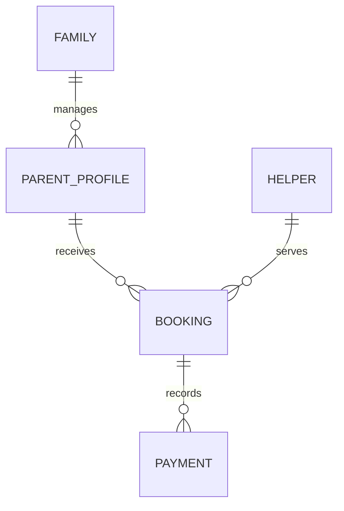

<div align="center">


# 🤝 DearHand

### Elderly Parent Care Booking Platform

**Helping families arrange consistent, verified support for elderly parents in Mysuru.**

[](https://github.com/9harshithp/DearHand)
[](#technology-stack)
[](#technology-stack)
[](#technology-stack)
[](#technology-stack)

</div>

------

## 🖥️ Application Showcase

<div align="center">



*DearHand — Connecting families with trusted elderly care helpers in Mysuru.*

</div>

---

## 📌 Project Overview

DearHand is a full-stack platform designed to help families book reliable home helpers for elderly parents in Mysuru. It connects families, helpers and platform administrators through a centralized booking and coordination experience.

The project combines an accessibility-conscious React frontend with a Java Spring Boot REST API, MySQL persistence, role-based authentication and Razorpay payment integration.

## 🎯 Problem Statement

Families who live away from elderly parents may find it difficult to arrange dependable everyday support. DearHand aims to simplify helper discovery, booking coordination, payment management and visibility into scheduled visits.

## 🌟 Platform Capabilities

| Role | Experience |
|---|---|
| Family | Manage parent profiles and coordinate helper bookings. |
| Helper | Participate in assigned care workflows and service coordination. |
| Administrator | Manage operational workflows, users and helper verification. |

### Engineering highlights

- Java Spring Boot 3 REST backend.
- Spring Security with JWT authentication and role-based access design.
- MySQL 8 persistence with Flyway database migrations.
- Razorpay integration with payment signature verification and idempotent webhook handling.
- API rate limiting.
- Responsive React interface with accessibility-conscious typography and interaction targets.
- Backend unit and integration test suite.
- Frontend deployment on Vercel and API deployment on Render.

These highlights reflect the supplied project README and résumé; consult the source and deployment configuration for the current implementation.

## 💻 Technology Stack

<div align="center">

</div>

| Layer | Technology |
|---|---|
| Frontend | React 18, Vite, Tailwind CSS |
| Backend | Java 17/21, Spring Boot 3 |
| Authentication | Spring Security, JWT |
| Database | MySQL 8 |
| Schema management | Flyway |
| Payment integration | Razorpay |
| Build and tests | Maven Wrapper, backend unit and integration tests |
| Local infrastructure | Docker, Docker Compose |
| Deployment | Vercel, Render |

## 🏗️ Architecture Overview



The monorepo separates the frontend, backend and product documentation. The diagram represents the application at a high level, not a complete class or deployment diagram.

## 🗄️ Conceptual Data Model



This is a conceptual model of the booking domain. Refer to the Flyway migrations and [project specification](docs/SPEC.md) for the actual physical schema.

## 🔐 Security & Payment Reliability

- JWT-based authentication using Spring Security.
- Role-based access design for family, helper and administrator workflows.
- Payment signature verification.
- Idempotent payment webhook processing to prevent duplicate handling.
- API rate limiting.
- Environment-based secret configuration.

No production credentials should be committed to the repository. Payment testing should use separate test-mode credentials.

## ♿ Accessibility & User Experience

DearHand is designed for a broad range of users, including older adults and their families:

- High-contrast interface design.
- Minimum 16px text size target.
- Minimum 44px interactive target size.
- Responsive layouts and clear booking workflows.

These are design targets rather than a claim of independently certified accessibility compliance.

## 🧪 Automated Testing

The project résumé reports **11 backend test classes**.

Run the current test suite to obtain actual pass/fail results:

```bash
cd backend
./mvnw test
```

On Windows:

```powershell
cd backend
.\mvnw.cmd test
```

## 📂 Repository Structure

```text
DearHand/
├── backend/           # Spring Boot REST API and backend tests
├── frontend/          # React/Vite/Tailwind application
├── docs/
│   └── SPEC.md        # Product, API and database specifications
├── .env.example       # Environment configuration template
└── README.md
```

## 🚀 Quick Start

### Prerequisites

- JDK 17 or 21.
- Node.js v18+ (the original README notes testing with Node 24).
- Git.
- Docker and Docker Compose.

### 1. Clone and configure

```bash
git clone https://github.com/9harshithp/DearHand.git
cd DearHand
cp .env.example .env
```

Configure the local environment values and development secrets before starting the application.

### 2. Start MySQL

```bash
docker compose up -d
```

The supplied local configuration uses MySQL on port 3306 and the `dearhand` database.

### 3. Start the backend

```bash
cd backend
./mvnw spring-boot:run
```

Backend: `http://localhost:8080`

Check the health endpoint:

```bash
curl http://localhost:8080/api/v1/health
```

Expected response shape:

```json
{
  "service": "dearhand-backend",
  "status": "UP",
  "version": "0.0.1-SNAPSHOT",
  "timestamp": "..."
}
```

### 4. Start the frontend

In a separate terminal, from the repository root:

```bash
cd frontend
npm install
npm run dev
```

Open [http://localhost:5173](http://localhost:5173). The Vite development server proxies `/api` requests to the backend on port 8080.

## ⚙️ Environment Variables

| Variable | Purpose | Local example |
|---|---|---|
| `DB_HOST` | MySQL hostname | `localhost` |
| `DB_PORT` | MySQL port | `3306` |
| `DB_NAME` | Database name | `dearhand` |
| `DB_USER` | MySQL username | `dearhand` |
| `DB_PASSWORD` | MySQL password | Set for local development |
| `PORT` | Backend port | `8080` |
| `JWT_SECRET` | JWT signing secret | Supply a secure 256-bit secret |
| `RAZORPAY_KEY_ID` | Payment test key identifier | Configure test-mode value |

See `.env.example` and backend configuration for all required variables. Keep production secrets in the hosting platform's environment settings.

## ☁️ Deployment

| Component | Platform |
|---|---|
| Frontend | Vercel |
| REST API | Render |
| Database engine | MySQL 8 |

## 📚 Documentation

- [Project specification](docs/SPEC.md) — product requirements, API definitions and database design.

## 🛣️ Product Roadmap

The original product plan includes:

- Database foundations and authentication.
- Helper onboarding and admin verification.
- Parent profiles and booking lifecycle.
- Helper matching, assignment and acceptance.
- Payment processing and receipts.
- Visit check-in/out, reviews and incident reporting.
- Notifications and administrator tools.
- Security hardening, automated tests and deployment.

Authentication, payment integration, rate limiting, backend tests and deployment are reported in the developer résumé; the completion status of other roadmap items should be verified against the current source.

## 🤝 Contributing

Open an issue to discuss improvements, create a feature branch, run the relevant tests and submit a pull request.

---

<div align="center">

## 👨‍💻 Developer

**Harshith P** — Backend Engineer | Full Stack Developer

[](https://github.com/9harshithp)
[](https://www.linkedin.com/in/harshithp914)
[](mailto:harshithp914@gmail.com)

⭐ If you find DearHand useful, consider starring the repository.


</div>
